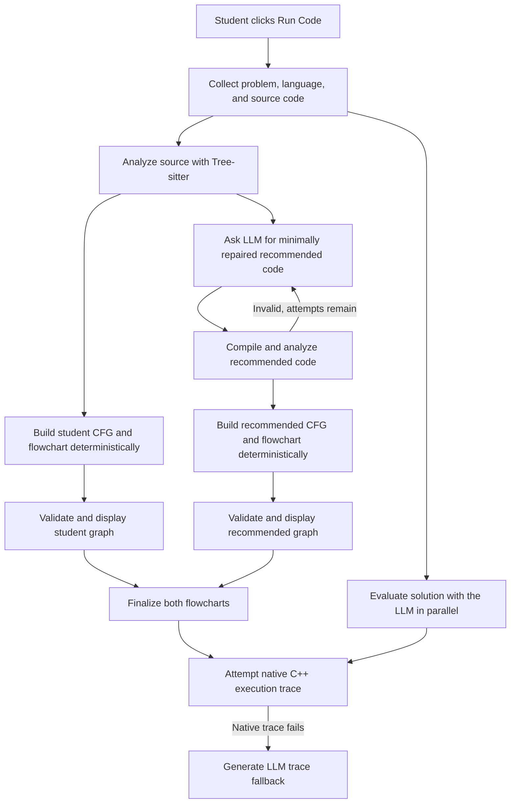

# Flowchart generation workflow

CodeFlow turns a student's Java, Python, or C++ solution into two comparable flowcharts: the student's logic and a recommended solution. The workflow combines source parsing, LLM generation, local validation, and automatic diagram layout.

## Overview

The diagram shows the main path. Transport failures and exhausted generation attempts produce an error; valid graph previews from the current attempt can remain visible.

## 1. Start a run

**Input:** The structured practice problem (title, description, examples, and constraints), the student's exact Java, Python, or C++ source, and the selected model configuration.

Clicking **Run Code** captures these inputs for the run and starts two independent tasks: solution evaluation and flowchart generation. Evaluation asks the model for a correctness verdict and test results; flowchart generation begins with source analysis. Model credentials travel in a separate request field, outside the prompt text.

**Output:** Two pending tasks with separate progress and result states. The Code Analysis panel opens immediately, and either task can publish its result without waiting for the other. Cancellation prevents late responses from replacing results from a newer run.

## 2. Analyze the source and build the student graph

**Input:** The selected language and original source code, sent to `/api/analyze-code`.

The backend uses the language's Tree-sitter grammar to build a syntax tree. It then walks that tree and extracts a compact list of facts: conditions, operations, exits, their nesting and branch relationships, and their source locations. Each fact receives an identifier such as `c1` or `p1`, called a source anchor. This analysis does not execute the code.

The backend also calculates `flowchartRequired` for each fact. Its simple rule excludes a statement when an earlier direct sibling in the same sequential block is an unconditional exit, such as `return`, `throw`, `break`, or `continue`. Other facts remain required. This field is computed by application code, not by the LLM, and is not a complete proof of reachability.

When syntax is malformed, Tree-sitter can still return a partial structure containing missing-token markers or `ERROR` regions. These markers let parsing continue without changing the source text. The backend collects them as `syntaxIssues`; the recovered structure may not reflect the student's intended nesting.

**Output:** A structured analysis object containing `facts`, function information, source locations, `syntaxIssues`, compiler diagnostics, and a `parseStatus` of `clean` or `recovered`. The same backend analysis constructs the student's control-flow graph and converts it to flowchart nodes and edges. The LLM does not generate or reinterpret the student's graph.

The parser result still determines the UI's source-analysis status:

| Mode | When selected | How the graph uses the source |
| --- | --- | --- |
| Grounded | The parser reports a clean parse with no syntax issues | The deterministic graph is grounded directly in the parsed source. |
| Inferred | The parser reports recovered syntax or syntax issues | The deterministic graph uses Tree-sitter's recovered structure and the UI identifies that the source required recovery. |

A clean parse does not establish that the program compiles or is logically correct. A parser request failure is reported as an error rather than selecting inferred mode.

## 3. Generate and validate recommended code

**Input:** The problem, language, exact student source, parser diagnostics, compiler diagnostics, and the selected model configuration.

The model proposes complete recommended source code, not graph nodes or edges. Its prompt applies a minimal-repair policy: retain the student's valid control structures, data structures, variable names, initialization style, ordering, and algorithmic approach whenever those choices are not the cause of the error.

The proposed code is parsed and compiled by the same source-analysis service. If it contains syntax, compiler, or graph-contract problems, those diagnostics are supplied to one additional recommendation attempt. CodeFlow fails the recommended-flow task if neither attempt produces valid code.

**Output:** Complete recommended source code that passes source analysis and compilation.

## 4. Build, validate, and publish both graphs

**Input:** The deterministic student graph and the analysis of the compiled recommended code.

The recommended analysis passes through the same CFG-to-flowchart builder as the student source. Both sides are therefore produced by the same structural transformation. Validation covers node IDs and kinds, existing edge endpoints, start and exit rules, labelled branches, and reachability from START. Source locations and parser recovery diagnostics remain attached to the student analysis for syntax highlighting and explanations.

**Output:** Validated graph objects published as progress, followed by a successful complete pair or an error state. The student graph can appear while the model is still preparing recommended code.

These checks establish structural consistency and compilation; they do not prove that the recommended algorithm satisfies every semantic requirement.

## 5. Arrange and display the flowcharts

**Input:** A validated graph's nodes, labels, syntax annotations, and edges. Each graph can enter this stage independently as it becomes available.

The frontend converts the graph into React Flow's rendering format and mounts the node boxes so their actual sizes and connection points can be measured. **ELK Layered** uses these measurements and the graph connections to calculate node positions and line routes, including bends around branches and loops. Layout changes presentation, not the CFG-generated connections or code labels. If ELK fails or times out, the application uses the **Dagre** fallback layout and displays a notice.

**Output:** Interactive student and recommended flowcharts displayed side by side, with syntax marks rendered on the relevant student labels. Students can pan, zoom, fit either diagram to its viewport, and open full-screen comparison and trace views.

## 6. Follow with an execution trace

**Input:** The completed graph pair, original problem and source, and a test input selected from the evaluation results. The application prefers a failing case, chooses the shortest input among the preferred cases, and excludes cases blocked by Java compilation errors or Python syntax errors. A case-specific runtime failure remains traceable because execution did start. If no case is traceable, it displays a reason and skips tracing.

For C++, the frontend first calls `/api/trace-cpp`. The backend instruments the student and recommended source, compiles each temporary program with `g++`, runs both under bounded time and resource limits, and maps the observed events back to the existing graph node IDs. This produces actual variable states and final outputs for the selected input.

If native instrumentation, compilation, execution, response validation, or graph-path validation fails—or recommended source is unavailable—the frontend automatically requests the existing model-simulated trace. A user cancellation never starts the paid fallback. The fallback receives the chosen input and expected result when available; the evaluation's reported student output remains outside its prompt so it can serve as an independent comparison.

The frontend checks that trace steps reference existing nodes and follow graph edges, and bounds the trace length. It also compares the completed student trace's output with the evaluation's reported output and shows a warning if they disagree.

**Output:** A trace for each graph containing visited node IDs, variable values, step notes, and a final output or truncation status. The trace appears below the comparison on another copy of the same graphs, with step controls. Students can also supply another input for a new trace.

Tracing is a follow-up to flowchart generation and does not regenerate the graphs. Successful native results use the internal source label `instrumented-cpp`; fallback results use `model-simulated`.

## Main implementation locations

| Responsibility | Main files |
| --- | --- |
| Start and coordinate the run | `frontend/src/MainContent.tsx`, `frontend/src/lib/analysisRun.ts` |
| Orchestrate deterministic flowcharts and recommended-code generation | `frontend/src/lib/flowchartClient.ts`, `frontend/src/lib/flowchartGeneration.ts` |
| Extract source facts and build CFG flowcharts | `backend/code_analysis.py`, exposed through `backend/app.py` |
| Define the recommended-code instructions | `frontend/src/config/systemPrompt_GenerateFlowchart.ts` |
| Select the provider and stream model output | `backend/model_config.py`, `backend/model_stream.py` |
| Validate graphs and recommended code | `frontend/src/lib/llmSchemas.ts`, `frontend/src/lib/flowchartClient.ts` |
| Display and arrange graphs | `frontend/src/RightContent.tsx`, `frontend/src/FlowchartDiagram.tsx`, `frontend/src/lib/elkFlowchartLayout.ts` |
| Generate the follow-up trace | `backend/cpp_execution_trace.py`, `frontend/src/lib/traceRun.ts`, `frontend/src/lib/traceClient.ts` |
